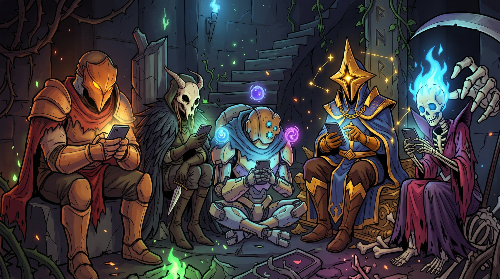

# Long Distance Play 🌐



> A mod that bridges **Couch Co-op** from LAN to WAN, making it possible to play Slay the Spire 2 anywhere, on-the-go.

Zero port-forwarding, zero VPNs, zero account setup. Friends join your run directly from their mobile browser or laptop via automated Cloudflare tunnels.

---

## Prerequisites & Mod Compatibility

- **[Couch Co-op](https://steamcommunity.com/sharedfiles/filedetails/?id=3799476240)** (Steam Workshop mod) must be installed and enabled.

> [!WARNING]
> **Mod Compatibility Notice:** This mod has not been fully tested with custom Character Skins, asset replacement packs, or heavy content overhaul mods. Running extensive skin/overhaul mods on the host may lead to desyncs, missing assets, or increased resource load across browser sessions.

---

## 🎮 How to Download & Install

> [!NOTE]
> Only the **Host** needs to install this mod and [Couch Co-op](https://steamcommunity.com/sharedfiles/filedetails/?id=3799476240). Remote players do not need to install anything—they just connect via their browser!

Pre-packaged releases are separated per platform with one-click installers included in [**Releases**](../../releases).

### Windows

1. Download `STS2-LongDistancePlay-v[version]-Windows.zip` from **Releases**.
2. Extract the archive.
3. Run `Install.bat` to install automatically (or manually copy the `STS2-LongDistancePlay` folder to `<Slay the Spire 2>/mods/`).
4. Launch the game.

### macOS (Apple Silicon / Intel)

1. Download `STS2-LongDistancePlay-v[version]-macOS.zip` from **Releases**.
2. Extract the archive.
3. Double-click `Install.command` (or run `./install.sh` in Terminal) for automatic installation and `steam_appid.txt` setup.
   - *Manual alternative:* Copy the `STS2-LongDistancePlay` folder to:
     ```text
     <Slay the Spire 2>/SlayTheSpire2.app/Contents/MacOS/mods/
     ```
     and ensure `steam_appid.txt` containing `2868840` exists in `<Slay the Spire 2>/SlayTheSpire2.app/Contents/MacOS/`.
4. On Apple Silicon, run the game under Rosetta 2 (right-click `SlayTheSpire2.app` > **Get Info** > check **"Open using Rosetta"**).

### Linux (Steam Deck / Desktop)

1. Download `STS2-LongDistancePlay-v[version]-Linux.zip` from **Releases**.
2. Extract the archive.
3. Run `./install.sh` in Terminal for automatic installation (or manually copy the `STS2-LongDistancePlay` folder to `<Slay the Spire 2>/mods/`).
4. Launch the game via Steam.

---

### Folder Structure Reference

```text
mods/
  couchcoop/
  STS2-LongDistancePlay/
    STS2-LongDistancePlay.dll
    STS2-LongDistancePlay.json
    STS2-LongDistancePlay.pck
    cloudflared.exe (optional, auto-downloads if missing)
```

---

## How to Use

### For the Host (PC):
1. In the main menu, click **Multiplayer -> Host Game** (or **Continue Run**).
2. On the **Character Select** screen, a button will appear on the selection screen (`🌐 Long Distance Play`).
3. Click **📋 Copy Link** (or open **📱 QR**).
4. Send the link or show the QR code to your friends.
5. Keep the game open in the lobby while players join.

### For Remote Players (Phone / Tablet / Browser):
1. Connect to the host using either method:
   - **Scan QR Code:** Scan the host's in-game QR modal with your phone/tablet camera.
   - **Type or Click URL:** Open the shared `https://<subdomain>.trycloudflare.com` link in any mobile or desktop browser (Safari, Chrome, Edge, Firefox).
2. Enter your player name, select your character, and click **Ready**.
3. Once all players are ready, the host clicks **Embark** to start the run!

### 💡 What if the Host Wants to Play On-the-Go Too?

The host PC controls **Player 1 (Seat 0)**. Opening the browser link on your own phone would assign you as Player 2, leaving Player 1 idle at home.

To leave your PC running at home and play on-the-go with your friends:
1. **Stream your host PC screen:** Use **[Steam Link](https://store.steampowered.com/app/353380/Steam_Link/)** (free on iOS/Android/macOS), **[Moonlight](https://moonlight-stream.org/) / [Sunshine](https://github.com/LizardByte/Sunshine)**, or **[Parsec](https://parsec.app/)**.
2. **Control Player 1 remotely:** Play from your mobile device or laptop with full host UI controls (Character Select, Embark, Deck, Combat).
3. **Friends connect via browser:** Your friends continue connecting through their web browser using the Cloudflare WAN link or QR code!

> [!TIP]
> Ensure host PC sleep mode is set to **Never** (`Windows Settings > System > Power > Sleep: Never`). You can safely turn off your monitor.

---

## Key Features

- **Global WAN Access:** Uses Cloudflare Quick Tunnels (`*.trycloudflare.com`) out-of-the-box. Free and instant.
- **In-Game Lobby HUD:** Live status indicator, one-click clipboard copy, and full-screen QR code dialog.
- **Seamless Reconnects:** If a player drops connection, their seat and deck are preserved for 2 minutes — simply refresh the browser tab to resume.
- **Save & Quit Supported:** Saved multiplayer runs restore character slots when continued from **Load Game**.

---

## 🔧 Troubleshooting & Connection Issues

If remote players encounter connection timeouts, infinite loading screens, or tunnel launch failures:

- **Firewall Blocking (Most Common):**
  - Antivirus or Windows Defender Firewall may block outbound tunnel traffic or local WebSocket relay.
  - Temporarily disable firewall to test, or allow both applications through firewall rules:
    - `SlayTheSpire2.exe` (in game root folder)
    - `cloudflared.exe` (inside `mods/STS2-LongDistancePlay/`)
  - In Windows: Navigate to **Windows Security > Firewall & network protection > Allow an app through firewall** -> check both Private and Public networks.
- **Port In Use:** Ensure port `13337` (or configured `TargetPort` in `config.cfg`) is free from other running services.
- **Third-Party VPN / Proxies:** Third-party VPNs or proxy tools may intercept WebSocket handshakes. Whitelist Slay the Spire 2 or test with VPN temporarily disconnected.
- **Mod Conflicts (Skins / Overhauls):** Custom character skins or heavy gameplay overhaul mods have not been tested with remote browser rendering. If experiencing desyncs, missing sprites, or seat crashes, test with third-party skin/overhaul mods disabled.

---

## Configuration (Optional)

`config.cfg` is generated automatically next to the `.dll`:

```json
{
  "AutoStart": true,
  "AutoCopyUrl": true,
  "TargetPort": 13337,
  "TunnelToken": "",
  "EnableInGameOverlay": true
}
```

- `TunnelToken`: (Optional) Enter a free Cloudflare Named Tunnel token for a permanent custom domain (e.g., `sts2.yourdomain.com`).
- `AutoStart`: Automatically start the tunnel upon entering the multiplayer lobby.
- `AutoCopyUrl`: Automatically copy the link to clipboard when the tunnel connects.

---

## Building from Source

Requirements: .NET 9.0 SDK, Windows x64.

```powershell
dotnet build -c Release
```
Compiles and auto-deploys to your local Steam STS2 installation.

---

## 🤖 AI Assistance

The mod artwork/banner (`preview.png`, `mod_image.png`) and packaging tooling scripts (`tools/`) were created with AI assistance. The core mod architecture, networking patches, and service logic in `/src/` is all me.

---

## License

This project is dedicated to the public domain under the [Creative Commons Zero v1.0 Universal](LICENSE) (CC0 1.0) license.
